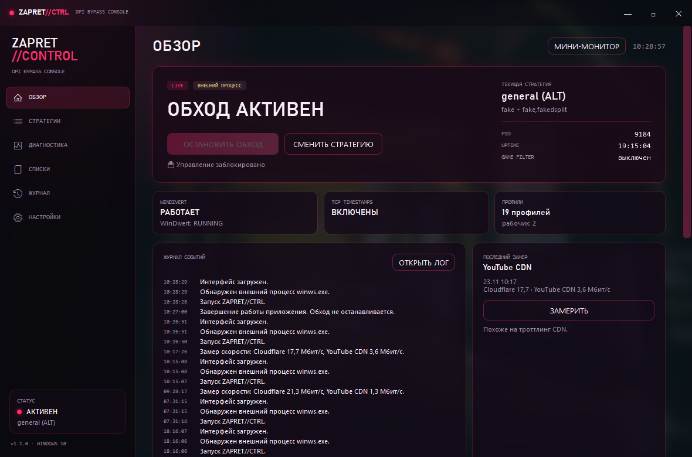
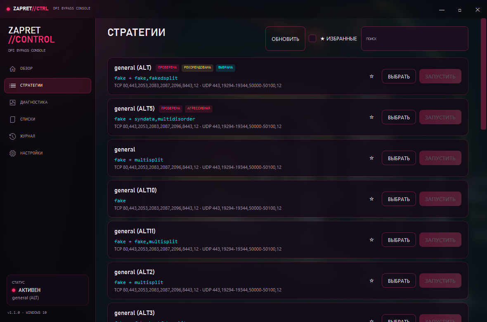
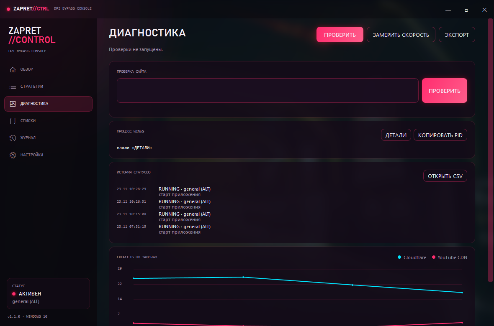
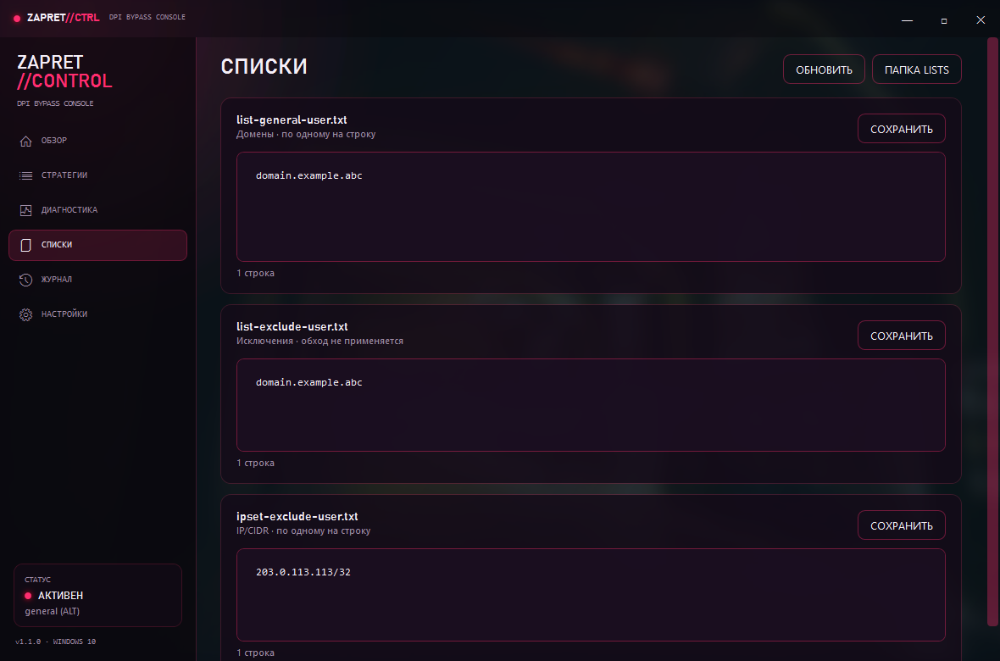
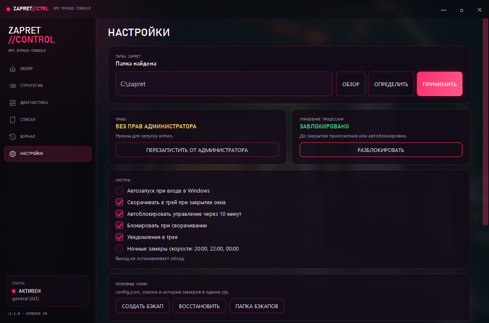
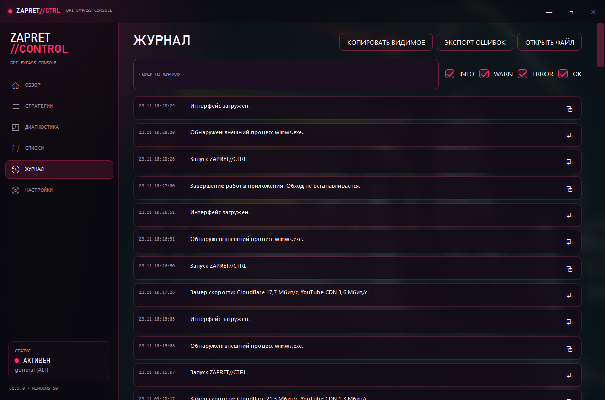
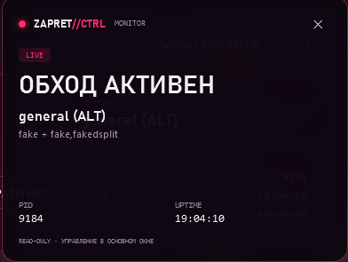

# ZAPRET//CTRL 1.1

Графическая панель для управления обходом блокировок через **zapret** (`winws.exe`) на Windows 10.

Тёмная неоновая тема: чёрный, маджента `#FF2D6F`, циан `#00E5FF`, жёлтый `#F2D06B`.



## О проекте

- Обёртка над уже установленным zapret: приложение читает профили `.bat`, запускает `winws.exe` с выбранной стратегией и показывает состояние.
- Это **не VPN** и не подмена DNS. Обход работает на уровне пакетов через WinDivert, как и сам zapret.
- Неофициальный GUI для zapret: проект не связан с авторами zapret.
- Приложение не устанавливает службы, драйверы и не меняет реестр, сетевые настройки или системные процессы.
- Единственное исключение — необязательный автозапуск: он создаёт задачу в Планировщике задач Windows только после явного включения галочки в настройках и удаляется той же галочкой.

## Возможности

- Один экземпляр приложения: повторный запуск поднимает уже открытое окно.
- Внешний `winws.exe` определяется по заголовку консоли — активная стратегия видна, даже если обход запущен не из приложения.
- Запоминание размера и положения окна между запусками.
- `F5` — обновить состояние, `Ctrl+D` — перейти к диагностике.
- Плавная прокрутка страниц колесом — работает и над списками, и над полями ввода.
- В трее: статус со стратегией и PID, мини-монитор, журнал, диагностика, папка zapret, включение/остановка обхода и выход.
- **Мини-монитор** — компактное always-on-top окно только для чтения: статус, стратегия, PID и uptime. Удобно для наблюдения с телефона.
- **Проверка сайта** — DNS и HTTP-ответ для любого домена. Результат можно сразу добавить в общий список или в исключения.
- **Избранные стратегии** — звёздочка и фильтр «только избранные».
- **Журнал** — поиск, фильтр по уровню, копирование строки, копирование видимого и экспорт ошибок.
- **История статусов** — запуски, остановки и внешние процессы сохраняются в CSV.
- **Детали процесса** — PID, родительский процесс, время старта, заголовок и командная строка `winws.exe`.
- **Резервные копии** — настройки, списки и история замеров в одном zip; перед восстановлением создаётся страховочная копия.
- **Портативный режим** — данные рядом с exe вместо `%LOCALAPPDATA%`.
- **Ночные замеры** — по расписанию в 20:00, 22:00 и 00:00, пока приложение запущено.
- **Уведомления в трее** — запуск и остановка обхода, завершение замера.
- **Автоблокировка управления** — через 10 минут или при сворачивании окна.
- Остановка обхода удержанием кнопки 1,2 секунды.
- На вкладках «Стратегии» и «Списки» есть кнопка **Обновить** — перечитывает `.bat`-профили и файлы списков без перезапуска.

## Безопасность

- При закрытии окна и выходе из приложения **`winws.exe` не останавливается**.
- По умолчанию управление процессами **заблокировано** (безопасный режим). Кнопка остановки неактивна, чтобы случайно не прервать текущий обход.
- Приложение останавливает только тот процесс, который запустило само. Внешний `winws.exe` можно остановить только после явной разблокировки в настройках и подтверждения.
- Если `winws.exe` уже запущен, приложение не запускает второй экземпляр и не трогает первый.
- Разблокировка действует только до закрытия приложения, автоблокировки или сворачивания окна.
- Приложение не убивает внешний `winws.exe` автоматически и не меняет системные настройки.

## Требования

- Windows 10 x64.
- [.NET 8 Desktop Runtime](https://dotnet.microsoft.com/download/dotnet/8.0).
- Установленный zapret с файлом `bin\winws.exe` и драйвером WinDivert.
- Права администратора для запуска и остановки обхода. Диагностика и чтение статусов работают без них.

## Быстрый старт

1. Запусти `ZapretControl.exe` из папки `publish` или `dist`.
2. Укажи папку zapret: **Настройки → Обзор → Применить**. Если папка лежит рядом, попробуй **Определить**.
3. Выбери стратегию на вкладке **Стратегии**.
4. Нажми **Запустить обход**. Для запуска `winws.exe` приложение предложит перезапуск с правами администратора.
5. Для остановки разблокируй управление в настройках и удерживай кнопку остановки 1,2 секунды.

## Профили

- `general (ALT)` — основной и самый аккуратный: `fake + fake,fakedsplit`, `fooling=ts`. Рекомендуется.
- `general (ALT5)` — агрессивный: `syndata + multidisorder`. Может помочь против более сложного DPI, но способен ронять скорость видео и вызывать ретрансмиссии. В интерфейсе помечен бейджем «АГРЕССИВНАЯ».

Остальные профили из папки `bin` тоже доступны в списке. Количество профилей зависит от содержимого `.bat`-файлов.

## Диагностика

- **Проверить** — только чтение: процесс `winws.exe`, служба WinDivert, TCP timestamps, сторонние DPI-инструменты, целостность профилей, VPN/прокси, HTTP-доступность Discord/YouTube/Google/Cloudflare и DNS. Ничего не останавливает и не меняет.
- **Проверка сайта** — DNS, HTTP-статус и задержка. Кнопки «В общий список» и «В исключения» добавляют домен в пользовательский список zapret.
- **Замерить скорость** — сравнивает Cloudflare и CDN YouTube.
  - YouTube измеряется через `i.ytimg.com`, потому что `www.youtube.com` в РФ часто не резолвится на уровне DNS.
  - Если вечером проседает только YouTube CDN, а Cloudflare держится — это похоже на троттлинг провайдера, а не на проблему DPI. В этом случае поможет туннель/VPN.
- История замеров: `%LOCALAPPDATA%\ZapretControl\speed-history.csv`.
- История статусов: `%LOCALAPPDATA%\ZapretControl\status-history.csv`.

## Списки

Вкладка **Списки** редактирует пользовательские файлы zapret:

- `lists\list-general-user.txt` — домены, которые нужно обрабатывать обходом;
- `lists\list-exclude-user.txt` — домены-исключения;
- `lists\ipset-exclude-user.txt` — IP/CIDR-исключения.

Перед сохранением создаётся `.bak`. После изменения списков перезапусти обход, чтобы применить их.

## Данные приложения

- Конфиг: `%LOCALAPPDATA%\ZapretControl\config.json`
- Лог: `%LOCALAPPDATA%\ZapretControl\logs\app.log`
- История замеров: `%LOCALAPPDATA%\ZapretControl\speed-history.csv`
- История статусов: `%LOCALAPPDATA%\ZapretControl\status-history.csv`
- Бэкапы: `%LOCALAPPDATA%\ZapretControl\backups\*.zip`

В портативном режиме данные лежат в папке `data` рядом с `ZapretControl.exe`. Режим включается галочкой в настройках или файлом `portable.flag` и применяется после перезапуска.

## Сборка

```powershell
$env:DOTNET_ROOT="$env:LOCALAPPDATA\dotnet-sdk"
$env:PATH="$env:DOTNET_ROOT;$env:PATH"

dotnet build .\ZapretControl.csproj -c Debug
dotnet publish .\ZapretControl.csproj -c Release -r win-x64 --self-contained false -o .\publish
```

Exe собирается как framework-dependent single-file: один файл, но нужен установленный .NET 8 Desktop Runtime.

Иконка `app.ico` генерируется скриптом:

```powershell
powershell -NoProfile -ExecutionPolicy Bypass -File .\tools\make-icon.ps1
```

Ярлык на рабочем столе создаётся скриптом:

```powershell
powershell -NoProfile -ExecutionPolicy Bypass -File .\tools\create-shortcut.ps1
```

## Скриншоты

| Стратегии | Диагностика |
| --- | --- |
|  |  |

| Списки | Настройки |
| --- | --- |
|  |  |

| Журнал | Мини-монитор |
| --- | --- |
|  |  |

## Ограничения

- Приложение не заменяет VPN: оно не шифрует трафик и не меняет страну выхода.
- Для запуска `winws.exe` и работы WinDivert нужны права администратора.
- Приложение не убивает процессы, которые не запускало, без явного подтверждения.
- Работоспособность обхода зависит от провайдера, DPI и выбранной стратегии.

## English

**ZAPRET//CTRL** is an unofficial Windows 10 GUI for the [zapret](https://github.com/bol-van/zapret) DPI-bypass package. It reads existing `.bat` profiles, starts `winws.exe` with the selected strategy, and shows the current state. It is not a VPN and does not change DNS, services, drivers, or registry settings.

Highlights:

- Safe mode by default: process control is locked; stopping or switching requires explicit unlock and confirmation.
- External `winws.exe` is detected by its console title and never stopped automatically.
- Compact always-on-top monitor, per-site DNS/HTTP check, favorites, searchable log, status history, process details, backups, portable mode, scheduled speed tests, and tray notifications.
- Exiting the app never stops the bypass.

Requirements: Windows 10 x64, .NET 8 Desktop Runtime, an existing zapret installation, and administrator rights to start/stop the bypass.

License: MIT — see [LICENSE](LICENSE).

## Лицензия

Проект распространяется по лицензии **MIT**. Полный текст — в [LICENSE](LICENSE).

## Версия

Текущая версия: **1.1.0**. История изменений — в [CHANGELOG.md](CHANGELOG.md).
